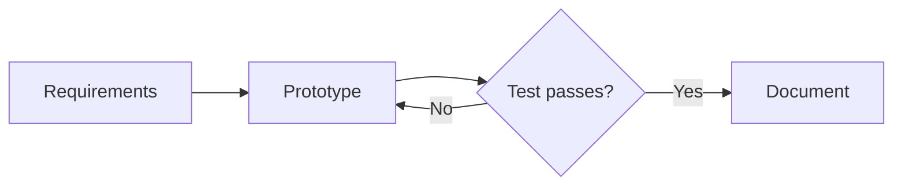

# Editing the wiki

All public notes are Markdown files in `content/`. Run `npm run build` after an edit. The build generates cards, filters, graph links, and backlinks, and reports broken internal links or missing linked files. Run `npm run check:links` to check links without replacing the generated notes.

## Note fields

Use plain `key: value` lines between the opening `---` lines. Keep values on one line; comma-separated fields do not need brackets or quotes. Every note should have `title` and `description`.

| Field | Meaning |
| --- | --- |
| `title` | Page and card title. |
| `description` | Short factual summary. |
| `type` | Set to `project` for project cards and project filters. |
| `status` | Hub/archive group: `current`, `past`, or `future`. |
| `featured` | `true` shows a current project on the homepage; `false` hides it there. |
| `order` | Numeric display order for featured projects. |
| `discipline` | Comma-separated disciplines, such as `Mechanical, Electrical, Computer science`. |
| `tags` | Comma-separated skills people can learn through the project, such as `CAD modeling, Firmware programming, Prototype testing`. Reuse existing spellings. |
| `lead` | Project lead or team name. Leave blank until assigned. |
| `contact` | Public contact email or HTTPS URL. Leave blank if unavailable. |
| `updated` | Date of the last meaningful note update, in `YYYY-MM-DD` form. |
| `next_milestone` | The next concrete project outcome. |
| `stage` | Displayed as **Status** on the project page: `completed`, `in design`, or `in testing`. |
| `image` | Path to a real feature photo, for example `/assets/uploads/laser-tag.jpg`. Leave blank to retain the blueprint placeholder. |
| `art` | Existing blueprint drawing key: `laser`, `synth`, `cart`, or `trebuchet`. |
| `hub` | Existing hub page kind, `projects` or `guides`; omit on ordinary notes. |

Copy `docs/project-template.md` into a new file under `content/projects/`, then replace its title, description, metadata, and starter sections. `updated` is a documentation date, not a claim that the project itself has finished a milestone.

Set `stage` to the project's actual progress. Keep `status` for its current/past/future group; when archiving a completed project, use `status: past` and `stage: completed`.

Choose a few concrete skill tags that fit the planned work, and replace the template's examples. These tags appear on project cards and notes and can filter both Projects and Complete graph. They describe learning opportunities, not prerequisites or completed milestones.

## Links and backlinks

Link another note with its wiki route:

```markdown
[CAD](#/guides/mechanical/cad)
[PCB design](#/guides/electrical/pcb-design)
```

Relative Markdown paths and `[[wiki links]]` are also supported. A note that links another note appears in that target's backlinks after the next build. Code examples do not create backlinks. Use real headings when linking a section; the build checks internal targets and anchors.

## Bills of materials

Use a normal Markdown table in the project note:

```markdown
| Item | Quantity | Specification | Status |
| --- | --- | --- | --- |
| Controller | TBD | I/O requirements TBD | Not selected |
```

The included BOMs are planning templates, not verified part selections. Replace TBD values only after the project has agreed on them. Keep the downloadable CSV and the table in the note consistent.

## Project files and downloads

Put real files in `assets/resources/<project-slug>/`. Link them from the project note with the full path beginning `/assets/resources/`. Local resource links become downloadable files in the wiki.

Existing starter resources are:

- `bom.csv`: an editable planning list with part number and supplier columns.
- `concept.svg`: a labeled conceptual block diagram; it is not a build-ready design.
- `design-brief.md`: an editable requirements, decisions, and test record.

CAD, STL, STEP, KiCad projects, schematic PDFs, firmware archives, and other files can use the same directory. Add a link only after the file exists. A missing local resource fails the link check. Name files clearly, identify their revision, and describe whether they are concepts, prototypes, or released build files.

Upload feature photos to `assets/uploads/` and set `image` to the actual filename. Do not put private credentials or private contact details in downloadable files or notes.

## LaTeX math

Use dollar signs or LaTeX parentheses for inline equations: `$E = mc^2$` or `\(I = \frac{V}{R}\)`. Equations work in paragraphs, lists, headings, and table cells. Keep inline delimiters on the same line, without spaces directly inside `$…$`. Escape a literal dollar sign with `\$`, or put it in inline code.

For a centered display equation, put double dollar signs (or `\[` and `\]`) on their own lines:

```latex
$$
\int_0^1 x^2\,dx = \frac{1}{3}
$$
```

KaTeX renders the supported LaTeX math commands, including fractions, subscripts, superscripts, sums, matrices, and aligned equations. It is a math renderer, not a full LaTeX document compiler. Code spans and ordinary fenced code blocks stay literal. Invalid equations show their source instead of breaking the note.

## Mermaid diagrams

Use a fenced code block with the language `mermaid`:

````markdown

````

Mermaid also supports sequence diagrams, state diagrams, and other built-in diagram types. Diagrams follow the light/dark theme and fit the content width. Invalid diagrams show their source and an error message. Mermaid runs in strict mode; scripts and diagram click callbacks are disabled.

Both renderers and their fonts are bundled under `assets/vendor/` and loaded locally. No CDN connection, API key, or package installation is needed. Build and serve the wiki normally with `npm run dev`; opening `index.html` directly as a file is not supported.
